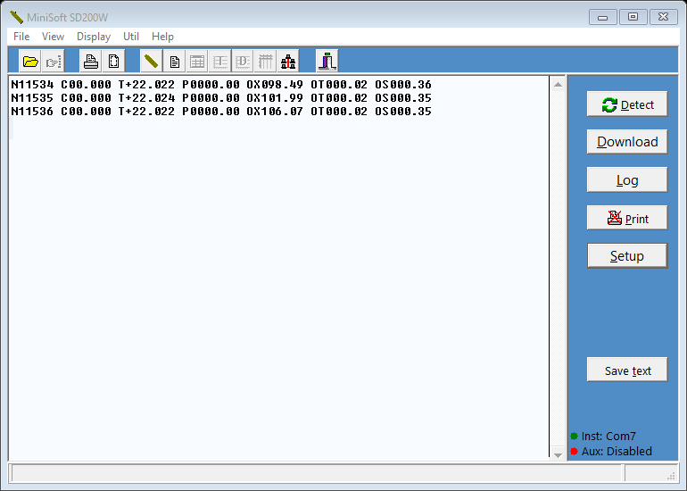
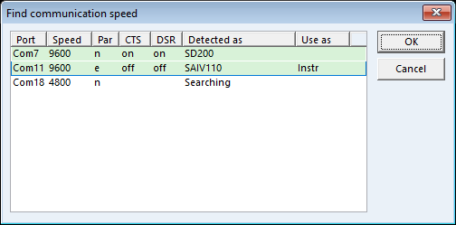

# SAIV Instrument Terminal

Windows-program for kommunikasjon med SAIV-instrumenter og loggere.

## Ny lokal leveranse

[SAIV Instrument Terminal 1.3.5](SAIV_Instrument_Terminal_v1.3.5_Sept2026.exe) leveres som **en EXE-fil**. Convert har Fahrenheit-valg med valgfri original Celsius-kolonne, og PAR-forklaringen viser ut-enheten. Valgene huskes, og eksisterende SD200W-beregninger er beholdt. Les [LES_MEG_Fahrenheit_PAR_135.md](LES_MEG_Fahrenheit_PAR_135.md).

## Nyeste tidligere verifiserte leveranse

[SD200W 1.0.3 Sept.2026](SD200W_SAIV_v1.0.3_Sept2026.exe) har mindre About/Disclaimer og OSU017 / SurfaceLogger i instrumentlisten. Se [LES_MEG_Compact_About.md](LES_MEG_Compact_About.md). Denne utgaven er foreløpig ikke publisert til GitHub.

## Publisert nedlasting (1.0.1)

**[Last ned SD200W 1.0.1 Sept.2026](https://github.com/BaardSagen/SD200w_R2/raw/refs/heads/main/SD200W_SAIV_v1.0.1_Sept2026.exe)**

Versjon i About og Windows-filinformasjon: **1.0.1 Sept.2026**.

SHA-256: `ebd75cdb4b93ff2e703b518550dfd2bce51490d8f12b6f0cb6f311f0a5f92068`.

Programfilen er usignert. Windows kan vise en advarsel ved første oppstart.

## Funksjoner

- Åpner Instrument-vinduet ved oppstart.
- Detect søker på flere COM-porter og gjenkjenner blant annet SD200, OSU107 og SAIV110.
- Velg instrument med klikk og OK, eller dobbeltklikk.
- Download håndterer disk-refresh for støttede loggere og viser beskjed dersom logging må stoppes først.
- Større terminalhistorikk og blått grensesnitt.
- CTS/DSR-flytkontroll deaktivert.

## Skjermbilder

Instrument-vinduet med terminal, måledata og snarveier:

Detect med to instrumenter funnet:

Klikk på ønsket rad og velg OK, eller dobbeltklikk raden. Bildene er fra tidligere tester av samme grensesnitt. Portnumre og signalstatus er eksempler fra testoppsettet.

## Videre arbeid på en annen PC

Start med **[OPPSTART_NY_PC.md](OPPSTART_NY_PC.md)** for oppsett, kontroll av filene og kjøring av tester.

- [Prosjektstatus og åpne punkter](sd200DOc/PROSJEKTSTATUS.md)
- [Formelkartlegging](sd200DOc/FORMELKARTLEGGING.md) og [formelkontroll](sd200DOc/FORMELKONTROLL.md)
- Alle `LES_MEG_*.md` i rotmappen beskriver tidligere endringer og leveranser.
- `analysis/`: byggskript, assembler, rekonstruerte formler, tester, manifester og analyseresultater.
- `analysis/runtime_test/`: historiske GUI-testresultater, skjermbilder og to forsøksprogrammer.
- `osu107Doc/`: loggerprotokoll, integrasjonsnotater og konverteringseksempler.
- `docs/`: historisk instrument-/firmwaredokumentasjon og referansemanualer.

Original og tidligere EXE-utgaver er bevart som inngangsfiler for hashbundne bygg og tester. **Siste lokale leveranse er SD200W_SAIV_v1.0.3_Sept2026.exe; publisert utgave er foreløpig 1.0.1.** Forsøksprogrammer i `analysis/runtime_test/` er ikke leveranser.

Original Delphi-kildekode finnes ikke i prosjektet. Videreutviklingen bygger på analyse og patching av Windows-programmet. Formelproblemer er dokumentert, men ikke rettet i EXE.

## ImGui 0.2.0 – enkel terminal

[Portabel utgave](saiv-studio/releases/SAIVStudio_0.2.0_Windows_x64.zip) og [komplett kilde](saiv-studio/releases/SAIVStudio_0.2.0_Source.zip). Åpner direkte i terminal med Autodetect/Download og direkte tegntasting. Se [README](saiv-studio/README.md). Erstatter 0.1.0-grensesnittet etter brukerens tilbakemelding.
